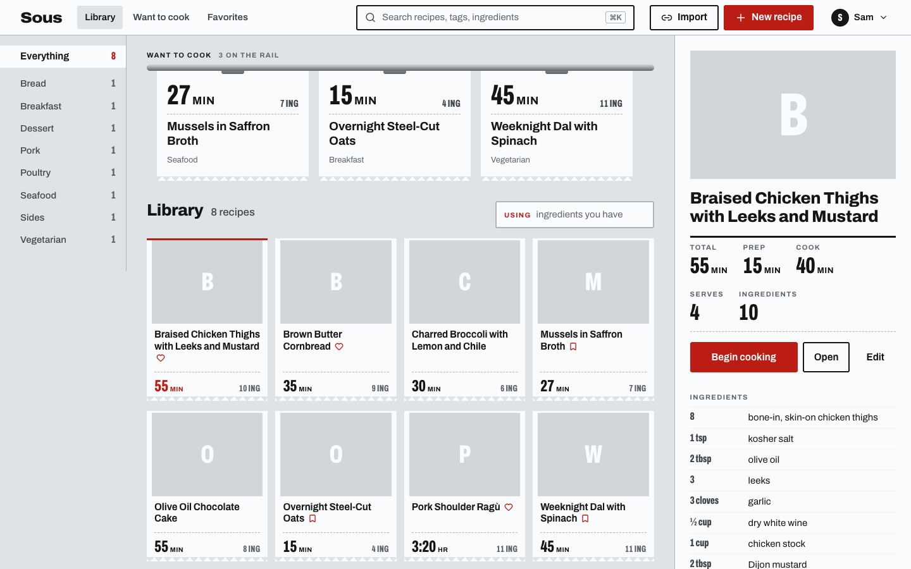
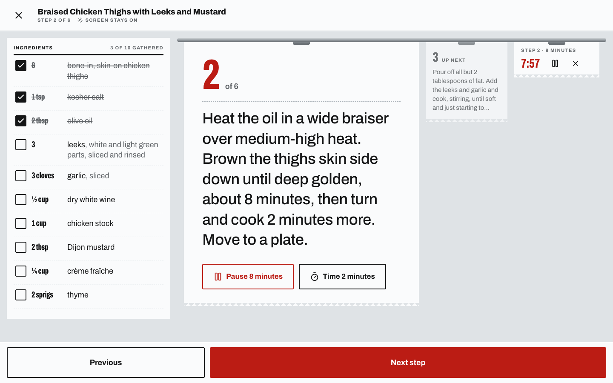
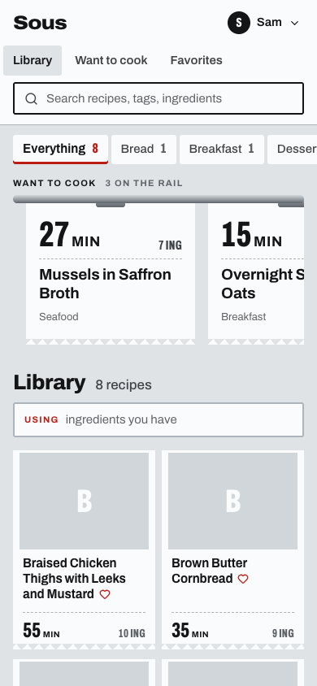

# Sous

[](https://github.com/sroberts/sous/actions/workflows/ci.yml)
[](https://github.com/sroberts/sous/releases/latest)
[](LICENSE)


A recipe library your whole household shares, on a computer you own. Save
recipes from any site in a couple of taps, cook from a screen that walks you
through each step with timers, and let an AI assistant search and add recipes
for you. It's one small program with nothing else to install, and everything
it keeps lives in one folder you can back up.



- **Import from a link.** Paste a link, or use the bookmarklet or iOS share
  sheet. Sous reads the recipe the page publishes and opens it for you to
  check before anything is saved. Sites that block it fall back to pasting
  the text.
- **Cook mode.** One step at a time in large type, with ingredients to tick
  off, timers that start from the step's own wording, and the screen kept on.
- **Shared, but personal.** One library for the household; favorites and
  want-to-cook are each person's own, and every change records who made it.
- **Agents built in.** AI assistants such as Claude can use the whole
  library over MCP, with the same rights and the same history as the web UI.
- **Run it your way.** As a service under
  [Outpost](https://github.com/sroberts/outpost), which signs everyone in and
  backs it up, or on its own.

Quick start, on a Mac with Apple silicon (Linux binaries are on the
[releases page](https://github.com/sroberts/sous/releases/latest)):

```sh
gh release download -R sroberts/sous -p sous-darwin-arm64
chmod +x sous-darwin-arm64
./sous-darwin-arm64 --port 8080 --data ~/sous-library   # then open http://127.0.0.1:8080
```

Sous is young: the basics work today, and the
[roadmap](#roadmap) lists what's coming.

## Install

Each [release](https://github.com/sroberts/sous/releases) has a binary for
Apple silicon Macs (`sous-darwin-arm64`) and Linux (`sous-linux-amd64`,
`sous-linux-arm64`), a `SHA256SUMS` file, and the `outpost.toml` Outpost
reads. Under Outpost, `outpost add` downloads and verifies it for you (below).
On your own:

```sh
gh release download -R sroberts/sous -p sous-darwin-arm64 -p SHA256SUMS
shasum -a 256 -c SHA256SUMS --ignore-missing
chmod +x sous-darwin-arm64 && mv sous-darwin-arm64 /usr/local/bin/sous
sous --version
```

A binary downloaded with a browser on macOS is quarantined, and macOS
refuses to open it; `xattr -d com.apple.quarantine sous-darwin-arm64` clears
that. `gh` and `curl` downloads aren't quarantined.

## Run it with Outpost

```sh
outpost add sroberts/sous    # latest release, checksum verified, port picked
outpost apply                # a running daemon starts it
```

Outpost gives Sous its port and storage directory, restarts it if it fails,
and lists it in the portal as "Sous". Day to day:

```sh
outpost status sous
outpost logs sous -f
outpost backup sous          # the whole library: database and photos
outpost update sous          # newer release; rolls back if it won't start
```

**With the login gateway on**, Sous takes who you are from your Outpost
sign-in. There's no "who's cooking?" prompt and no switching people; your
name in the top bar links back to Outpost for your account, signing out, and
your other apps. If your sign-in ends while a page is open, Sous says so and
offers to sign you in again. A person's username in Outpost is their identity
in Sous, so use the same one if you move a library over.

**Without the gateway**, Sous behaves as it does on its own (next section):
each device picks who's cooking.

## Run it on its own

```sh
sous --port 8080 --data ~/sous-library
```

Then open http://127.0.0.1:8080. `--data` is where Sous keeps everything
(a SQLite database and a folder of photos) and is created if it's missing.
`sous --help` lists every setting.

- **First run.** A new Sous comes with twelve recipes, credited to "Sous".
  Seven are historic, from Hannah Glasse's 1751 curry to Escoffier's 1907
  Peach Melba, each with a modern adaptation, the original text and a period
  illustration, and tagged Historic. Five are classics written for Sous and
  tagged Classic: boeuf bourguignon, poulet au vinaigre, steak frites and a
  French omelette, inspired by Julia Child, Paul Bocuse, Anthony Bourdain and
  Jacques Pépin, and a flourless chocolate torte. Delete them and they stay deleted. Sous only adds
  them to a library that has never been used, so a restore that brings
  recipes or history never gets them (restoring a never-used library can), and
  `SOUS_SAMPLES=false` skips them on that start.

- **Who's cooking.** There are no accounts. The first time a device makes a
  change, Sous asks who's cooking and remembers the answer on that device.
  Anyone who can reach Sous can pick any name; it records who did what, it
  doesn't keep anyone out. Passwords are planned in
  [#6](https://github.com/sroberts/sous/issues/6).
- **Other devices.** Sous only listens on `127.0.0.1`, so only this machine
  can reach it. To use it from a phone or tablet, put something in front that
  you trust to decide who gets in, such as
  `tailscale serve --bg 8080` for your tailnet, or a reverse proxy with its
  own login.
- **Keeping it running.** Sous runs in the foreground and stops cleanly on
  Ctrl-C or SIGTERM, so any supervisor works: a launchd agent, a systemd
  unit, or `tmux`.
- **Backups.** Stop Sous and copy the `--data` directory. While it runs,
  `sqlite3 sous.db ".backup sous-backup.db"` copies the database safely; copy
  the `images` folder alongside it.
- **Updating.** Replace the binary and restart. Sous upgrades its database
  on start.

## Agents (MCP)

MCP clients connect to `/mcp` on the same port, with the same tools as the
REST API, including `import_recipe`. Every change is attributed to a person:

- **On its own:** `http://127.0.0.1:8080/mcp`, with an `X-Sous-Person:
  <username>` header naming who the agent acts for.
- **Under Outpost:** connect on loopback (Outpost assigns the port; see
  `outpost status sous`) with the same header. The gateway itself only lets
  in people signed in with a browser, and `SOUS_REQUIRE_GATEWAY=true` closes
  the loopback route too, so leave it unset if agents need MCP.
- **Access tokens:** the gateway also accepts an Outpost access token
  (`Authorization: Bearer opat_…`) and passes Sous the same signed identity as
  a login. Scripts and the Siri Shortcut use this to reach Sous from outside.
  MCP still connects on loopback, as above.

The REST API is described at `/v1/openapi.json`.

## Importing from a link

In the web UI, choose **Import** in the masthead (or "Import from a link" on
the new-recipe page), paste a link, and Sous reads the recipe into the editor
for you to check before saving. The `/import` page also shows how to set up a
bookmarklet for desktop browsers and an iOS Shortcut for the Share Sheet; both
open `/import?url=…`. If a site blocks Sous or has no recipe data, paste the
recipe text instead. Agents use the MCP tool `import_recipe`. Details are in
[`spec.md`](spec.md) §14.

To read and save in one step, `POST /v1/recipes/import` with `{"url": "…"}`.
It saves the recipe, or returns the copy you already have, and replies with a
`summary` short enough to speak. The `/import` page shows how to build a Siri
Shortcut on it: share a recipe page, or say "Hey Siri, Save to Sous".

## Moving from Mela

A one-time, throwaway script loads the Mela export through the REST API. The
app itself carries no Mela code. The export is not committed.

```sh
uv run scripts/mela-import/mela_import.py Recipes.melarecipes \
    --url http://127.0.0.1:8080 --person scott --name Scott
```

`--dry-run` reads and maps the export without sending anything. Re-running
skips what's already there, so an interrupted import can just be run again.
Details are in [`spec.md`](spec.md) §11.

## What it does today

- **Library:** browse by course, a want-to-cook rail, favorites, and search
  by title, tag or ingredient. The "using" filter finds recipes that use
  what you have.
- **Recipes:** ingredients are parsed into amount, unit and item, with the
  original line kept; steps, times, yield, notes, nutrition and photos.
- **Cook mode:** step by step, ingredient check-offs, step timers, screen
  stays on.
- **Editor:** a live preview of how each ingredient line was read.
- **Import:** from a link (schema.org JSON-LD, microdata or h-recipe), the
  bookmarklet, the iOS Shortcut, or pasted text, with photos stored and
  duplicates caught by link. From Mela, with a one-time script.
- **Household:** per-person favorites and want-to-cook, a history of who
  changed what, and deleted recipes can be restored.
- **Interfaces:** the web UI, a REST API described at `/v1/openapi.json`,
  and MCP tools with the same reach.



<p align="center"></p>

## Roadmap

Planned in [`spec.md`](spec.md) §13, not built yet:

- Scaling a recipe by servings, and US ↔ metric conversion
- A weekly meal plan and a combined shopping list grouped by aisle
- Collections, ratings, personal notes and cook history
- An installable app that works offline for recipes you've opened
- Passwords for running Sous on its own ([#6](https://github.com/sroberts/sous/issues/6))

## Development

[`CONTRIBUTING.md`](CONTRIBUTING.md) has the workflow, the rules, and what
CI checks.

```sh
cd web && npm ci && npm run build && cd ..   # build the UI into the binary
go run ./cmd/sous --port 8099 --data ./.dev-data
```

Then open http://127.0.0.1:8099. `.dev-data/` is gitignored. Without the UI
build, the binary still runs and serves a page saying how to build it.

```sh
go test -short ./...   # unit and API tests
go test ./...          # plus the Outpost conformance suite, which builds the binary
```

The design: [`spec.md`](spec.md) for the service, and
[`outpost-spec.md`](outpost-spec.md) for the Outpost contract it keeps:
loopback only, port from `--port` or `OUTPOST_PORT`, health at `GET /up`,
foreground, clean SIGTERM shutdown, logs to stdout. All state lives in the
storage directory, so `outpost backup` and `restore` cover everything.

### The web UI

The UI lives in `web/` (Svelte 5 + Vite) and builds into `internal/ui/dist`
for the Go binary to embed. The Vite dev server answers `/v1` with a mock API
(`web/mock/`); `MOCK_OUTPOST=<username> npm run dev` makes it act as the
Outpost gateway, signed in as that person.

```sh
cd web && npm install && npm run dev
```

The mock serves a few sample recipes from `web/mock/fixtures.json`, plus the
twelve a new library starts with (`internal/samples/data`). To design
against the real library instead, extract the Mela export into the
gitignored `web/mock-local/`:

```sh
uv run --no-project scripts/mela-sample/sample.py Recipes.melarecipes web/mock-local
```

### Checking the importer against real sites

The importer's tests run offline against saved fixtures. To check the real
sites, run the live check, which fetches the 25 links in
`internal/importer/testdata/testset.json` and prints how each one read:

```sh
go test -tags live -run Live -v -count=1 ./internal/importer
```

To re-record the fixtures, then regenerate and review the expected output:

```sh
go test -tags live -run Live -v -count=1 ./internal/importer -record
go test -run TestFixtures ./internal/importer -update
git diff internal/importer/testdata/pages   # review the *.want.json files
```

Fixtures hold only the extracted recipe data and the link back to the source
(the recipe's JSON-LD, or the recipe's microdata element), never a whole page.
A test fails if one contains page markup or grows past 200 KB.

## License

[MIT](LICENSE)
